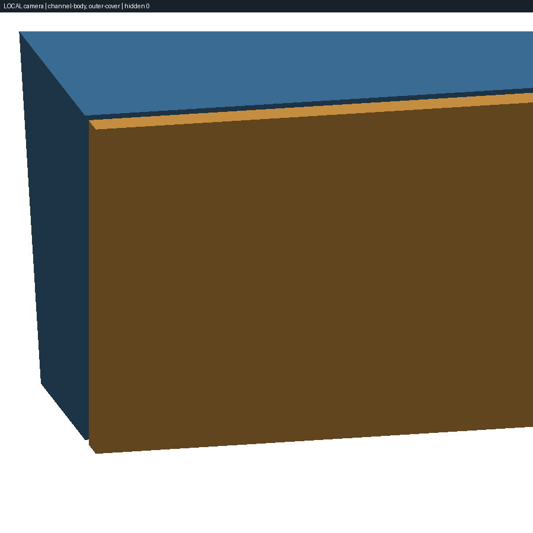
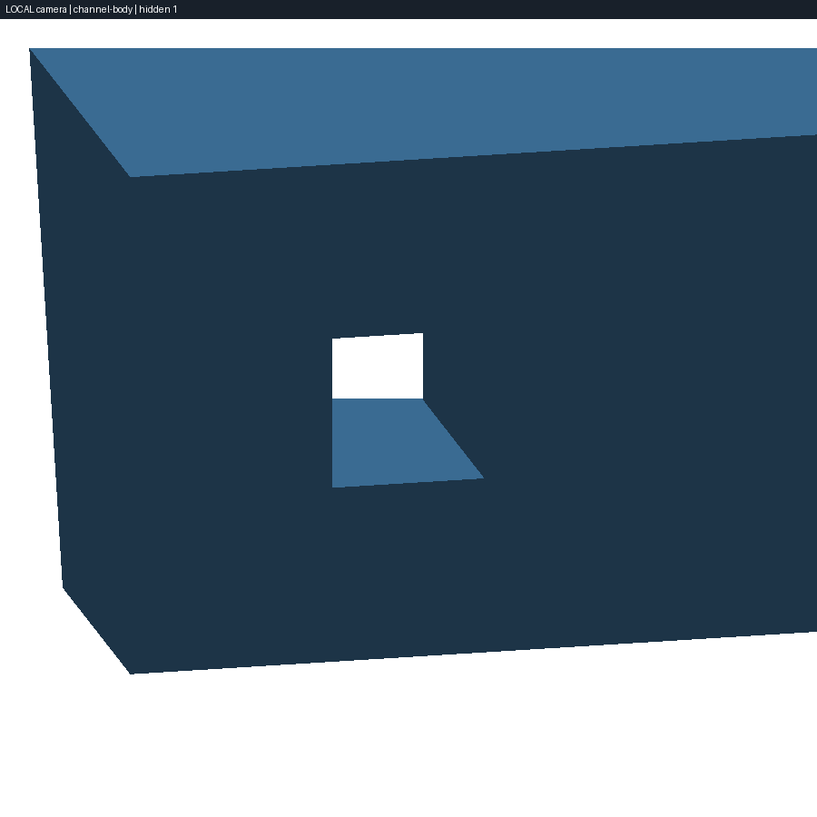
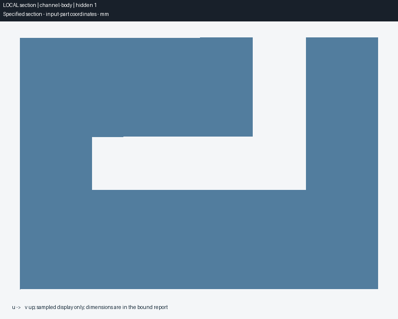

# RFC #33：视觉反馈闭环验收记录

日期：2026-10-22。对应 [RFC #33](https://github.com/amagine-ai/Amagine3D/issues/33)、[PR-1 #35](https://github.com/amagine-ai/Amagine3D/pull/35) 和 [PR-2 #36](https://github.com/amagine-ai/Amagine3D/pull/36)。本报告随资源边界与证据声明修正补丁提交。

## 结论与证据范围

按需观察在真实 Agent 任务中可用：Agent 自行选择相机方向、对象、局部范围和剖切平面，直接从绑定 STEP 取得支持判断的图像与数字测量。已有证据的说明补充、重复汇总没有新增构建、观察或 checkpoint。实现核查同时发现并补齐了累计 STEP 输入预算、原生分配边界、超时测试及旧 stage 依赖的缓存新鲜度；真实任务发现的“旧图结论沿用到新报告”也通过提示修正和后续真实运行验证。

**不宣称总体提速或普遍质量提升。** 两个单次配对任务中，完整建模变慢，已有几何的遮挡检查变快。固定了任务、模型和推理配置，但未随机化顺序、重复抽样或控制服务端缓存，不能作因果推断。检查图像送达不等于证明模型理解正确；几何结论另由 STEP/BRep 和预先固定的 fixture 真值核对。

## 方法与计数口径

- Before：`f5f398751583bc16c221ca7ca163a0866c5e74d5`，PR-1 的直接父提交；After：`93f4a9234485feedaefedf0f1cb58292fa7b7cdb`，PR-2 合并后的 main。两份源码快照各自运行对应 runtime、CLI 与 skill，共用已安装依赖，无新增安装。
- 产品运行时沿用已配置的 `deepseek-flash`、`low` reasoning、关闭搜索。6 Luna 负责实现和测试执行，不冒充被测产品模型。每组新任务使用独立工作区，后续说明/汇总在该组线程恢复；两组之间不传递答案。两种图像通路先经随机颜色视觉探针验证。
- 完整建模与两组 inspection 顺序运行，期间暂停其他长测试。Before 说明补充和重复汇总与一次 API 测试有时间重叠；后续声明/提示补充测试也可能与代码验证重叠，其时间只留档，不用来判断性能优劣。
- 总耗时覆盖 `runTurn` 起止，包括失败命令、返工、读图和最终回复。命令数是 SDK 完成的 `command_execution`；原生工具调用数、非零退出数和模型响应记录另存于 [metrics.json](rfc-33-validation/metrics.json)。CLI `--help` 和文档中的命令文字不算执行的 CAD 操作。
- 原生 `view_image` 的 call ID 必须与实际 `input_image` 输出匹配才算送达。SDK 恢复线程时返回累计 usage，因此后续回合用前后累计值之差；cached input 是 input 的子集，reasoning output 是 output 的子集，不能重复相加。无货币费用推算。
- 所有提示词、起止时间、会话标识、原始日志哈希、几何数据和截图哈希收录在 metrics 文件。原始日志与完整 CAD 工件保存在执行工作区 `workspace/rfc-33-validation/`，未公开凭据、提供商地址或原始会话内容。

## 完整任务与已有几何检查

| 任务 / 版本 | 秒 | 完成命令 | draft / compile | preview | checkpoint | 送达图像 | input tokens（含 cached） | output tokens |
| --- | ---: | ---: | --- | ---: | ---: | ---: | ---: | ---: |
| 定位垫块 / before | 148.192 | 46 | 1 / 1 | 0 | 1 | 2 | 1,391,320 | 22,128 |
| 定位垫块 / after | 241.118 | 63 | 1 / 3 | 0 | 0 | 3 | 2,695,450 | 31,708 |
| 遮挡与通道 / before | 341.825 | 46 | 0 / 0 | 0 | 1 | 18 | 2,754,812 | 56,443 |
| 遮挡与通道 / after | 177.396 | 44 | 0 / 0 | 2 | 0 | 8 | 1,499,147 | 32,340 |

定位垫块需求：32×20×6 mm、中心 Ø5 贯穿孔、四个外部竖边 R1 圆角、平底、单色打印，生成可编辑模型及 STEP/STL/3MF 并完成既有验证。After 首次孔刀具位置有误，之后又调整了模型底面对齐，因而多了两次 compile 和多次测量；没有调用新 preview。保留这次较差耗时，不把它归因于或隐藏在首图速度中。

独立重新读取两个完整任务结束时的绑定 STEP：均为一个实体，包围盒 `[−16,−10,0]..[16,10,6]`；Z=0.1/3/5.9 的三个截面均有一个 Ø5、中心 X=Y=0 的孔，外轮廓周长 `102.28318530718083 mm`，与四角 R1 相符。精确体积与解析值的差小于 `1e-8 mm³`。两份编译均 `pass=true`、无 issues，仍为 `awaiting-visual-review`、`visualReviewRequired=true`；这不是制造或交付批准，也没有实物打印验证。

遮挡任务是预先固定的已有草稿检查，不计为完整制造任务：40×28×20 主体减去两段相交通道，加上独立外罩，再整体绕 Z 旋转 37°。真值为侧口连通、L 形转弯连通、外罩沿开口法向遮挡且有 1 mm 空隙。两组原始 source、STEP、scene、对象 STEP 和 overview 的六个哈希及 latest run 均未改变。Before 额外导出反旋转检查副本并编写绘图脚本；一次导出失败、一次临时文件清理被运行时拒绝，均保留在记录中。After 两次 preview 批量完成 camera/section，八张图实际送达；两次 inspect 字段/哈希请求失败也计入成本。

After 自选的方向为 `[-0.4261152, 0.9310348, 0.3]`，target 为旋转后的开口中心；对比相同方向的两个对象与仅主体，选择世界 AABB 作为相机取景范围，再选 `z=10` 水平剖面和沿旋转后局部 `x=9` 的竖剖面。水平主体截面材料面积 `910 mm²`，竖截面 `458 mm²`，与通道并集真值相符。没有人工指定这些参数，也没有按产品名称分支。

| 相同相机：外罩保留 | 相同相机：隐藏外罩 |
| --- | --- |
|  |  |

这些是局部证据。标签明确 LOCAL 和 hidden 数量，完整参数在 manifest/metrics 中；`scope` 是投影盒产生的相机视口与深度裁剪，不是任意角度下严格的世界 AABB 裁剪。剖面图是采样轮廓，数字测量来自同一 BRep；不能外推全局壁厚、密封性、强度或制造验收。

## 无新增视觉需求的后续任务

| 后续任务 | before 秒 / 命令 / 模型响应记录 | after 秒 / 命令 / 模型响应记录 | build / preview / checkpoint / 读图 |
| --- | --- | --- | --- |
| 只补 README | 25.118 / 7 / 6 | 33.873 / 6 / 7 | 两组全部为 0 |
| 相同需求重复汇总 | 11.355 / 2 / 3 | 8.549 / 3 / 2 | 两组全部为 0 |
| 冻结 intent 的证据说明修订 | 53.292 / 17 / 16 | 104.953 / 31 / 25 | before 全部 0；after 1 compile，其余 0 |

说明与重复汇总的源文件、原冻结 intent、STEP 和 latest 未变；After 只增加 README 和操作计数日志。模型响应数有自然波动，不能声称所有后续任务 token/轮次完全相同；能确认没有新增必经视觉步骤。

**声明修订不能记作“零构建验证通过”。** 两组均新增 intent 文件，只修改外形尺寸的 evidence 文字并保留父版本，validate 通过。After 额外执行一次 compile 和两次 measure，mutable intent-history 与 latest 随之更新，原源文件/冻结 intent/交付 STEP 未改。修订类型为 evidence-correction，但既有审计把该 evidence 字段变化记录为 target-change。Before 在 validate 后停止。

既有 [evidence contract](../skills/a3d-public/references/evidence-contract.md) 已要求修订 intent 经 compile 绑定；这条规则在 Before 提交中也存在。RFC 的“没有新增必选构建”指视觉流程的增量，不能覆盖原冻结声明合同。该样本证明没有额外 preview/checkpoint/读图，不能证明声明修订的总成本为零，也不能据此把旧编译报告重标为新声明的验收结果。更细的“证据文字变化免编译”需要另行定义合同，未在本 RFC 中更改。

## 真实运行发现的证据声明问题

原 After 定位垫块实际读取了 draft 和前两个 compile 的图，最后一次 compile 没有对应读图，却称“当前主图已人工检查”。Before 也使用了“人工”字样。这是运行观察到的缺陷，不计作成功视觉验收。

本补丁要求：只有实际 `view_image` 读取且路径/哈希仍匹配当前 report 的图，才能称该报告做过 Agent 检查；新报告不继承旧图结论；未读取时如实说明；不得把 Agent 检查称人工。仍由任务需要决定是否读图。

使用修正 runtime 提示、冻结 After CLI/skill、相同“重复汇总”提示，在同一线程后续新 compile 上再次运行：10.205 秒、3 个命令、2 个模型响应记录，0 build/preview/checkpoint/view_image。最终明确写“当前最新 report 尚未执行新的 Agent 视觉检查”，保留 pending 状态。该补充只验证提示行为，不冒充新一轮完整性能对照，也不保证所有未来生成均无错误。

## 资源、缓存与兼容性收口

- 256 MiB 预算累计父 STEP 与所选唯一子 STEP，在 OCC 加载前预检；大文件 SHA-256 分块读取。scene descriptor 仅从 STEP artifact 上的嵌套绑定或同一精确 run 中 path+SHA 相同的输出绑定恢复；否则发现旁侧 descriptor 时明确拒绝，不据此选择潜在不同的 child STEP。
- 旧 stage 只有先通过工作区路径和哈希校验、再与父报告 cadStage 完全一致才能用于对象恢复；无绑定时不解析旁侧 stage，plain STEP 仍按整体几何观察。stage/scene/对象绑定进入缓存键与 inspect 新鲜度，篡改不能继续显示 current。
- CLI preview 在固定 CAD 库加载后、几何加载/三角化之前安装最多 2 GiB 新增分配边界：POSIX 为 RLIMIT_AS 地址空间，Windows 为 Job Object 每进程 committed memory，保留更严格的继承限制。**这不是跨平台 RSS 峰值上限。** Windows 外层 Job 可能更严，availableBytes 不假报为固定 2 GiB。
- 原有 500k 三角形上限仍在 tessellation 后检查；原生分配边界和 120 秒 deadline 保护此前阶段。超时先 SIGTERM，再于 5 秒宽限后强制终止；真实短时限测试等待子进程就绪后触发，覆盖忽略 SIGTERM 的情况。
- 缓存区分生成时的 `generationProcessMemoryBoundary` 和本次调用的 `processMemoryBoundary`，策略文件进入 renderer fingerprint。原有对象/像素/图片/注册项/缓存容量及工作区限制继续有效。
- [OS 分配边界测试](../tests/python/test_preview_resource_limits.py) 使用真实 64 MiB 增长预算阻止 128 MiB 分配，已加入 Ubuntu/Windows CPU 矩阵；[API 回归](../tests/python/test_agent_api.py) 覆盖累计预算、stage/child 篡改、真实 CLI 混合观察、工件不变性、缓存和旧命令；[deadline 测试](../tests/preview-deadline.test.ts) 覆盖生产 helper 与真实子进程。合并仍以该 PR 对应提交的 CI 全绿为准。

本地复用现有依赖完成 `tests.python.test_agent_api` 54 项、STEP/display/CAD 草稿兼容回归 31 项、共享 Skill 测试 10 项、完整 Node 测试 188 项、`npm run typecheck` 和 `npm run build`。Build 通过但保留现有大 chunk 提示；本机已装 Vite 7.3.6、lockfile 固定 7.3.7，因此不在本地安装/变更依赖，锁定版本由 PR 的 `npm ci` CI 验证。Windows Job Object 分支及其余平台结果也以该 PR 的 CI 为准。单次 STEP 微基准仍只说明加载共享和缓存成本，不能替代本报告的完整任务数据或充当峰值 RSS 测量。
